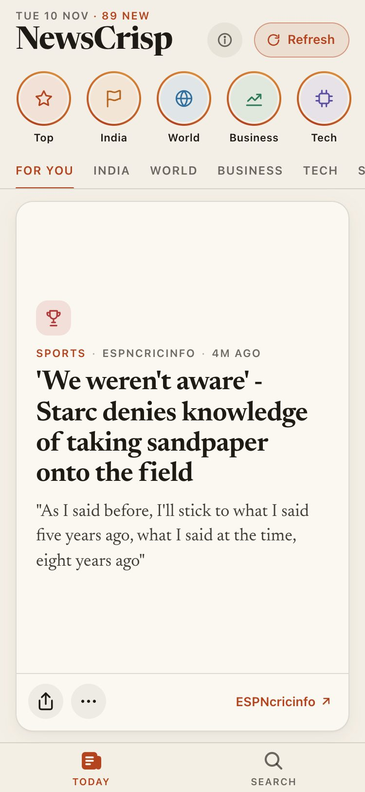
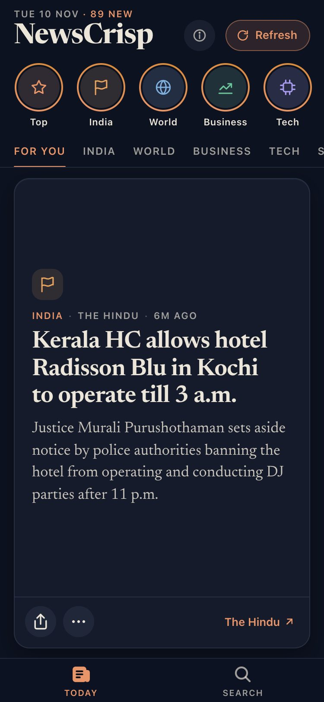
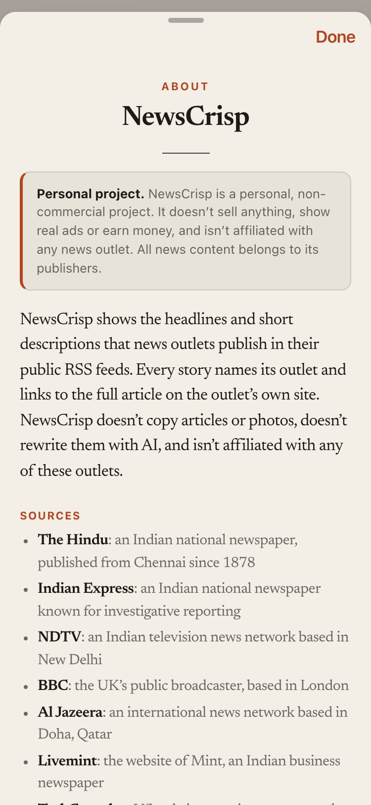
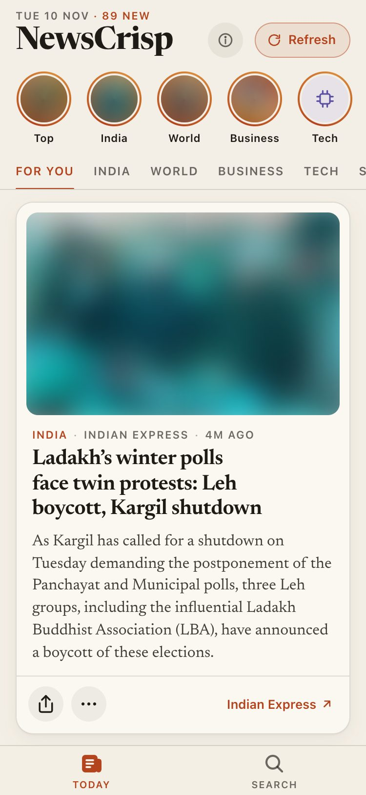

# NewsCrisp

Today's news, one story per screen. Swipe up for the next story, tap a story to read more, and follow the link to the full article on the publisher's site.

> **Personal project.** NewsCrisp is a personal, non-commercial project. It doesn't sell anything, show real ads or earn money, and isn't affiliated with any news outlet. All news content belongs to its publishers.

The same code runs as one of two editions:

- **Public edition** (the default): safe to share. It shows only what news outlets publish in their public RSS feeds: headline, short description and a link back.
- **Private (full) edition**: for personal use. It shows publisher photos and longer summaries made from the full article. It's protected by a password when hosted.

**Try it:** [newscrisp.vercel.app](https://newscrisp.vercel.app/) runs the public edition. The private edition is password-protected and isn't open to the public.

## Screenshots

### Public edition

<table>
  <tr>
    <td align="center"></td>
    <td align="center"></td>
    <td align="center"></td>
  </tr>
  <tr>
    <td align="center">Feed (light)</td>
    <td align="center">Feed (dark)</td>
    <td align="center">About page and disclaimer</td>
  </tr>
</table>

### Private (full) edition

Publisher photos are blurred in these screenshots because they belong to the news outlets. The app shows them normally.

<table>
  <tr>
    <td align="center"></td>
    <td align="center"></td>
    <td align="center"></td>
  </tr>
  <tr>
    <td align="center">Feed with photos</td>
    <td align="center">Stories viewer</td>
    <td align="center">Full story page (dark)</td>
  </tr>
</table>

## Features

### In both editions

- **One story per screen:** a vertical feed that snaps to each story and always opens on the first one.
- **Stories:** round topic bubbles ("Top", India, World, Business, …) open full-screen slides. Tap right for the next one, left to go back, hold to pause, and drag down to close. Bubbles you've fully watched move to the end of the row.
- **Full story page:** tap any story for the headline, the summary, where the text came from, a line about the outlet, and a button to the full article.
- **Topics and search:** filter by topic on the Today tab, or search every story on the Search tab.
- **Your choices:** "Show less" of a topic or "Hide" an outlet from the ⋯ menu, both with Undo. What you've read is remembered on your device only.
- **Refresh:** a labelled button that shows progress and says how many new stories it found.
- **About page** (the ⓘ button): the disclaimer, the list of sources and a privacy note.
- **Light and dark mode:** it follows your device setting. Dark mode is deep navy with a copper accent.
- **Accessibility:** follows your text size on iPhone, and respects Reduce Motion, Reduce Transparency and Increase Contrast.

### Public edition vs private (full) edition

| | Public edition | Private (full) edition |
|---|---|---|
| Story text | The outlet's own feed description, at most 40 words | A 45–60 word summary from the full article; written by Claude AI if you add an API key |
| Article pages | Never read | Read to build the summaries |
| Photos | None; a topic icon instead | The outlet's photos |
| AI summaries | Off | On if `ANTHROPIC_API_KEY` is set |
| Placeholder ad cards | No | Yes (not real ads) |
| "Report a problem" | No | Yes, saved to a local file |
| Sharing a story | Headline and link | Headline, summary and link |
| Password | None, open to everyone | Required when hosted (`SITE_PASSWORD`) |

## What you need

- **Node.js 20.9 or newer** (it comes with npm). Check with `node --version`.
- **Git**, to download the project.
- Optional: an **Anthropic API key** from [console.anthropic.com](https://console.anthropic.com), for AI summaries in the private edition. Using it costs money, but well under a cent per refresh.

## Run the public edition

1. Download the project and go into its folder:

   ```bash
   git clone https://github.com/YOUR-USERNAME/newscrisp.git
   cd newscrisp
   ```

2. Install what it needs (only the first time):

   ```bash
   npm install
   ```

3. Start it:

   ```bash
   npm run dev
   ```

4. Open http://localhost:3000. The app is designed for a phone-sized screen; on a computer it shows as a narrow column. To see it at phone size, open your browser's device mode (Chrome: right-click → Inspect → the phone icon).

Stop it with **Ctrl + C** in the terminal.

## Run the private (full) edition

```bash
npm run dev:full
```

Open http://localhost:3000. On your own computer it opens without a password.

**On Windows**, `npm run dev:full` doesn't work in Command Prompt or PowerShell. Use the settings file below instead: add the line `NEWSCRISP_EDITION=full` to `.env.local`, then run `npm run dev`. Remove the line to go back to the public edition.

### Turn on AI summaries (optional)

1. Create a file called `.env.local` in the project folder, next to `package.json`. It's a hidden file, so on a Mac press Cmd + Shift + . in Finder to see it.
2. Add your key to it:

   ```
   ANTHROPIC_API_KEY=sk-ant-your-key-here
   ```

3. Stop the app (Ctrl + C) and start it again with `npm run dev:full`. The app only reads `.env.local` when it starts.

`.env.local` is never uploaded to git, so your key stays on your computer. Summaries are written by `claude-haiku-5-5`, Anthropic's low-cost model.

## Settings

Put these in `.env.local` when running on your computer, or in your host's environment variable settings (on Vercel: Project → Settings → Environment Variables).

| Setting | What it does | Edition |
|---|---|---|
| `NEWSCRISP_EDITION` | Set it to `full` for the private edition. Leave it out for the public one. | both |
| `SITE_PASSWORD` | The password for the hosted private edition. Use 12 or more characters. Without it, a hosted private edition refuses to load instead of opening up. | private |
| `ANTHROPIC_API_KEY` | Your Claude API key, for AI summaries. | private |
| `USE_AI` | Set it to `0` to turn AI summaries off even when a key is set. | private |
| `NEXT_PUBLIC_CONTACT_EMAIL` | An email address shown on the About page so publishers can ask to be removed. Set it before building; changing it needs a new build. | both |

## Run the production build on your computer

This is the same build a host runs. It's faster than `npm run dev`, and it's the only way to try the password locally.

```bash
npm run build
npm start
```

For the private edition with a password (Mac or Linux):

```bash
npm run build
NEWSCRISP_EDITION=full SITE_PASSWORD=choose-a-long-password npm start
```

Your browser will ask for a user name and password. Any user name works.

## Host it for free on Vercel

You can host both editions from one GitHub repository as two separate Vercel projects.

1. Push the project to a GitHub repository. It can be public: the code holds no secrets, and the private edition is protected by `SITE_PASSWORD` in Vercel's settings, not by the repository. Never commit `.env.local` or a password (git already ignores `.env*` files).
2. Sign in at [vercel.com](https://vercel.com) with GitHub.
3. **Public edition:** Add New → Project, import the repository, and name it, for example, `newscrisp`. Leave the settings empty and click Deploy.
4. **Private edition:** Add New → Project, import the **same** repository again, and name it, for example, `newscrisp-full`. Under Environment Variables add:
   - `NEWSCRISP_EDITION` = `full`
   - `SITE_PASSWORD` = a long password
   - `ANTHROPIC_API_KEY` = your key (optional)

   Then click Deploy.
5. Each project gets its own free address, such as `newscrisp.vercel.app`. Every push to GitHub updates both.

Good to know:

- A Vercel address is public as soon as it deploys, even without a custom domain. The private edition is protected only by `SITE_PASSWORD`, so share that password only with people you trust.
- Vercel's free plan is for personal, non-commercial use.
- Vercel doesn't keep files, so "Report a problem" in the hosted private edition doesn't save reports.

## How it gets the news

1. The server reads 13 public RSS feeds from 9 outlets: The Hindu, Indian Express, NDTV, BBC, BBC Sport, Al Jazeera, Livemint, TechCrunch and ESPNcricinfo. It keeps the result for 10 minutes, so every visitor in that time shares one copy.
2. Stories several outlets covered are merged into one ("Also reported by…"), and the 90 newest are kept.
3. The **public edition** uses each feed's own short description. The **private edition** also opens each article's page to read the story text, then summarizes it with Claude if a key is set; otherwise it shows the article's opening sentences. Some sites block automated reading; those stories keep the feed text.
4. The app gets everything from one address, `/api/feed`, and every story credits its outlet and links to the original article.

### Add or remove a news source

1. Edit `src/lib/sources.ts`: each source has a name, an RSS feed address and a topic.
2. Add a one-line description of the outlet to `SOURCE_ABOUT` in `src/lib/client.ts`. It appears on the story page and on the About page.
3. Restart the app.

## Where things are

| What | File |
|---|---|
| News sources | `src/lib/sources.ts` |
| Which edition is running | `src/lib/edition.ts` |
| Password gate for the private edition | `src/proxy.ts` |
| Reading feeds, merging duplicates, 10-minute cache | `src/lib/news.ts` |
| Reading article pages (private edition) | `src/lib/article.ts` |
| Summaries (AI or fallback) | `src/lib/summarize.ts` |
| Reports file (private edition) | `src/lib/store.ts` |
| API | `src/app/api/feed/route.ts`, `src/app/api/report/route.ts` |
| Screens and components | `src/components/` |
| Styles, colours, fonts | `src/app/globals.css`, `src/app/layout.tsx` |

## Legal note

The public edition only shows what outlets publish in their public feeds, credits every outlet, and links to the original. That lowers the risk, but feed terms differ between outlets: check them before any commercial use. The private edition copies article text and photos, and several outlets ask that their content not be used with AI. Keep it private and behind its password. This note isn't legal advice.

## Troubleshooting

- **"Port 3000 is in use":** another copy is already running. Stop it with Ctrl + C, or open the address it's already serving.
- **I changed `.env.local` but nothing changed:** stop the app with Ctrl + C and start it again.
- **The hosted private edition says it's locked:** add `SITE_PASSWORD` in the host's settings and redeploy.
- **The password box keeps coming back:** the password is wrong. Any user name works, but the password must match `SITE_PASSWORD` exactly.
- **Some stories show only a headline:** that outlet's feed had no description for that story. Tap the story for the link to the full article.

## Not done yet

- User accounts and likes: they need a database.
- Push notifications.
- Better duplicate detection; it currently compares headline words only.
